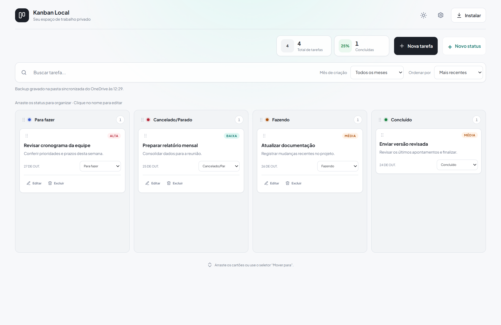
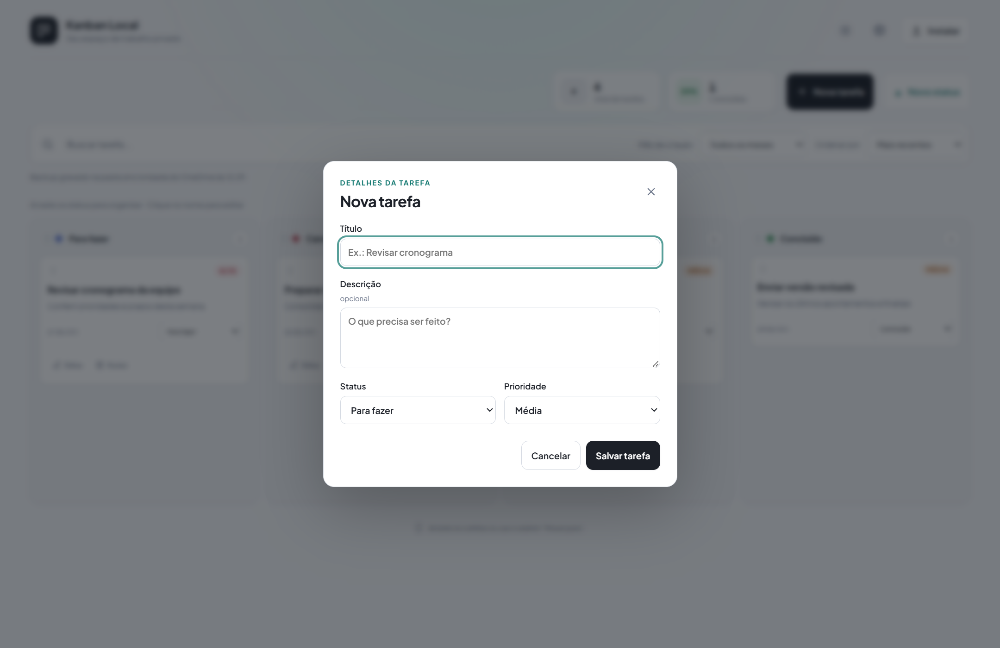

# Kanban Local

Um quadro Kanban simples para organizar tarefas no navegador. Os dados ficam no armazenamento local do navegador, com opções de exportação/importação e suporte a backup pelo servidor local.

[Abrir demonstração online](https://famel-svg.github.io/Kanban/)

## Recursos

- Quatro colunas iniciais e criação, renomeação e reordenação de status.
- Criação, edição, movimentação e exclusão de tarefas.
- Prioridade, busca, filtros por mês de criação e ordenação.
- Arrastar e soltar cartões, com alternativa acessível para mover tarefas.
- Tema claro e escuro, com preferência salva.
- Exportação e importação de backups em JSON.
- Aplicativo instalável (PWA) e cache offline após o primeiro carregamento.
- Backup automático pelo servidor local, com pasta configurável.

## Requisitos

- Windows para usar os atalhos `.bat` e `.vbs`; o servidor também pode ser executado em outros sistemas com Python 3.
- Python 3 para executar o servidor local.
- Navegador moderno. Animações usam Animate.css via CDN e precisam de internet; os recursos principais continuam funcionando offline após o carregamento inicial.

## Como executar

Na pasta do projeto, execute:

```powershell
py -3 server.py
```

Abra [http://localhost:8080](http://localhost:8080). Também é possível iniciar pelo `iniciar-kanban.bat`. O `iniciar-kanban.vbs` foi feito para abrir o servidor em segundo plano no Windows.

A instalação como aplicativo está disponível em navegadores compatíveis quando o Kanban é aberto por `localhost` ou HTTPS. Abrir `index.html` diretamente funciona, mas não habilita todos os recursos de instalação e offline.

## Dados e backup

As tarefas e preferências são armazenadas no navegador. Use **Configurações → Exportar backup** para salvar uma cópia JSON, ou **Importar backup** para restaurar uma cópia.

O servidor local oferece backup automático. Por padrão, grava em `OneDrive - NUCLEO ENGENHARIA/Documentos/Kanban Backups` dentro do perfil do usuário. Para escolher outro destino, defina `KANBAN_BACKUP_DIR` antes de iniciar o servidor:

```powershell
$env:KANBAN_BACKUP_DIR = 'D:\Meus backups\Kanban'
py -3 server.py
```

O backup depende do servidor estar ativo. Se usar uma pasta sincronizada em nuvem, a sincronização também depende do cliente correspondente estar conectado. Exporte backups JSON periodicamente como cópia adicional.

### Limites e compatibilidade

- O quadro usa `localStorage`: cada navegador e endereço (origem) têm dados separados. A demonstração online não sincroniza dados com `localhost` nem com outros dispositivos.
- A demonstração no GitHub Pages é somente estática; não executa o servidor Python e, por isso, não oferece backup automático. Use **Configurações → Exportar backup** para guardar os dados e **Importar backup** para restaurá-los.
- Para backup automático e restauração pelo servidor, execute localmente com Python 3 e acesse `http://localhost:8080`.
- A instalação como PWA requer HTTPS ou `localhost` e suporte do navegador. Abrir `index.html` diretamente permite uso básico, mas não instalação nem todos os recursos offline.
- As animações usam Animate.css via CDN e requerem internet; os recursos principais continuam disponíveis offline depois do primeiro carregamento e ativação do cache.
- Os atalhos `.bat` e `.vbs` são específicos do Windows.

## Testes

```powershell
node tests/app.test.cjs
py -3 -m unittest discover -s tests
```

## Imagens




